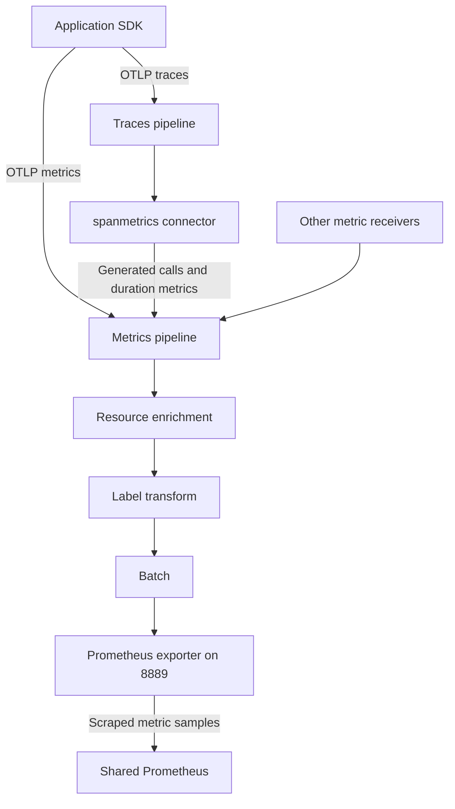

# Understanding Collector metric labels

This guide explains why some metrics were missing from the Collector's Prometheus
endpoint, how the label fix works, and what still needs checking on EKS.

We use **OpenTelemetry Collector Contrib 0.135.0**. It exposes application metrics
on the private **8889** endpoint. Prometheus retrieves them by making regular HTTP
requests to `/metrics`; this is called **scraping**.

An application SDK is a library that collects telemetry. It can send that data
to the Collector using OTLP, OpenTelemetry's data transfer protocol. Collector
receivers accept or collect data, processors modify it, and exporters send or
expose it to another system.

The change is limited to `transform/metric-labels` in the
[relay configuration](../../apps/opentelemetry-demo/base/otel-collector-relay.yaml).
The existing receivers, logs/traces pipelines, debug exporter, spanmetrics
connector, port 8888 and Collector self-monitoring configuration stay the same.

## 1. Understand the two types of attributes

An **attribute** is a key/value pair attached to telemetry. Resource attributes
and datapoint attributes describe different things:

| Type | What it describes | Example | Common source |
|---|---|---|---|
| Resource attribute | The application or infrastructure producing telemetry | `service.name="checkout"` | Application SDK configuration or Collector resource enrichment |
| Datapoint attribute | A particular measurement or metric series | `http.request.method="GET"` | Instrumentation library, application code, receiver or connector |
| Prometheus label | The exported key/value pair used to filter and group metrics | `service_name="checkout"` | Collector Prometheus exporter |

For example, an HTTP metric can have this structure. This is an illustration,
not the full OTLP message format:

```yaml
resource_attributes:
  service.name: checkout
  service.version: "0.2.0"
  k8s.namespace.name: otel-demo-dev
metric_name: http.server.request.duration
datapoint_attributes:
  http.request.method: GET
  http.response.status_code: 200
```

In our Deployments, `OTEL_RESOURCE_ATTRIBUTES` supplies application service name
and version. The Collector's `k8sattributes` processor can add namespace metadata
when it associates telemetry with a Pod. Our `resource/environment` processor sets
`deployment.environment.name` from `DEPLOYMENT_ENVIRONMENT`.

Resource attributes do not automatically become labels on every application
metric. Our transform deliberately copies only the labels needed for direct
service and environment filtering.

## 2. Follow the data through the Collector



The **spanmetrics connector** turns spans into request counts, error counts and
request duration metrics. These are often called **RED metrics**: Rate, Errors
and Duration. It already puts `service.name` on its metric datapoints.

## 3. Understand the duplicate-label problem

The old transform copied resource `service.name` to datapoint `service_name`
without checking which datapoint keys were already present.

A spanmetrics datapoint could therefore become:

```yaml
datapoint_attributes:
  service.name: checkout   # Already generated by spanmetrics
  service_name: checkout  # Added by our old transform
```

Those are different OpenTelemetry keys. The Prometheus exporter converts both
names to `service_name`. This name conversion is called **normalization**.
Prometheus cannot use the same label name twice on one sample, so conversion fails:

```text
failed to convert metric traces.span.metrics.calls: duplicate label names in constant and variable labels
```

Equal values do not make duplicate names acceptable. The affected samples can be
missing even when `/metrics` returns **HTTP 200**. Always check expected samples
and Collector errors, not only the HTTP response status.

Local tests reproduced this problem using spans through the real connector.
Synthetic HTTP metrics also reproduced the mechanism. However, we have not yet
identified the exact attributes that caused the original live HTTP failures.

## 4. Understand the new label rules

### Environment: trust the platform configuration

Kustomize overlays hold environment-specific Kubernetes configuration. Our
overlays configure these values, and regression tests check each mapping:

| Kubernetes namespace | Collector `DEPLOYMENT_ENVIRONMENT` |
|---|---|
| `otel-demo-dev` | `dev` |
| `otel-demo-staging` | `staging` |
| `otel-demo-prod` | `prod` |

First, `resource/environment` creates or replaces resource
`deployment.environment.name`. Then the metric transform copies that value to
`environment`, overwriting any incoming datapoint value.

For example, a dev Collector changes incoming `environment="prod"` to
`environment="dev"`. This is deliberate: platform configuration decides which
environment produced the telemetry.

The transform's `!= nil` check only checks presence. Correctness comes from the
controlled overlay configuration and its tests. A nonblank-string check alone
would not prove that an environment value belongs to the correct namespace.

### Service: preserve existing identity and add a fallback when needed

The service rule works in three steps:

1. Copy the current datapoint attributes into temporary
   `cache["existing_service_name_aliases"]`.
2. Filter that copy to find keys that the pinned exporter would convert to
   `service_name`. These equivalent names are called **aliases**.
3. Add `service_name` from the resource only when no alias exists and resource
   `service.name` is a nonblank string.

The cache is temporary working storage. It is not a new metric label or a
persistent cache service. Filtering the copy preserves the original datapoint.

The filter uses `^service[^a-zA-Z0-9]name$`. It matches `service`, followed by one
character other than an ASCII letter or digit, followed by `name`. Examples
include `service.name`, `service_name`, `service-name`, `service name`, and
`service💡name`; all become `service_name` in the pinned exporter.

`service..name` becomes `service__name`, so it is a different label and does not
block fallback enrichment. This rule follows the
[pinned exporter naming code](https://github.com/prometheus/otlptranslator/blob/94f535e0c5880f8902ab8c7f13e572cfdcf2f18e/strconv.go).
Recheck it when upgrading the Collector or changing exporter naming settings.

| Existing datapoint attribute | Resource `service.name` | Result |
|---|---|---|
| None | `checkout` | Add `service_name="checkout"` |
| `service.name="frontend"` | `checkout` | Preserve the existing key and value; exporter produces `service_name="frontend"` |
| `service_name="frontend"` | `checkout` | Preserve `service_name="frontend"` |
| None | Missing, empty, spaces/tabs only, or a number | Add no service label |
| Both `service.name` and `service_name` | Any value | Preserve both; report the existing input collision rather than discard a value |

`IsString(...)` rejects non-string resource values. `IsMatch(...,
"[^[:space:]]")` rejects strings with no character outside the regex's whitespace
class. These checks validate the fallback value; the empty-cache check prevents
adding a duplicate. We do not invent service identity for infrastructure metrics.

Only `environment` deliberately overwrites an incoming datapoint value. Existing
service and unrelated datapoint attributes are preserved. Exporter-generated
`job` and `instance` still use resource identity, so `job` can describe a different
service from a preserved datapoint `service_name`.

## 5. Find version and namespace metadata in Prometheus

We removed automatic copies from resource `service.version` and
`k8s.namespace.name` onto datapoints. The resource attributes themselves remain.
Existing datapoint attributes with those names also remain.

Direct service and environment labels support our required queries. Direct
version and namespace labels are optional for this task; adding them everywhere
would introduce more potential collisions without a demonstrated query need.

The exporter exposes resource metadata in a separate metric called `target_info`
by default. Its value is 1; its labels contain the useful metadata. A simplified
example is:

```prometheus
target_info{job="opentelemetry-demo/checkout",instance="pod-123",service_version="0.2.0",k8s_namespace_name="otel-demo-dev",deployment_environment_name="dev"} 1
```

Our local test checks that version, namespace and environment resource metadata
are present there. Missing source metadata is not invented. The pinned exporter
[documents this behavior and query joins](https://github.com/open-telemetry/opentelemetry-collector-contrib/blob/v0.135.0/exporter/prometheusexporter/README.md#setting-resource-attributes-as-metric-labels).

To use resource-only metadata with application metrics, a dashboard may need a
**join**: combine series using matching identity labels. The future scrape
configuration must preserve a unique source identity and account for its handling
of `job` and `instance` before those joins are accepted.

For direct service/environment filtering, a query can use:

```promql
sum by (environment, service_name) (
  rate(traces_span_metrics_calls_total{environment="dev"}[5m])
)
```

This is an illustrative query, not a live Prometheus test result. The original APP
APM dashboard expects some other direct labels, including
`deployment_environment_name` and `service_namespace`. Its queries therefore need
separate compatibility testing against this label contract.

## 6. Run the local checks and understand the results

From the repository root, put `kubectl` on PATH and use Python with PyYAML. Replace
the executable paths below with your local paths. The Collector must report
**0.135.0**. Without `OTELCOL`, the exporter script skips binary validation and
runtime integration; a static-only pass is not a full pass.

Rendering an overlay generates the final Kubernetes YAML without applying it to
a cluster. Config validation checks whether the pinned Collector accepts that
configuration. The runtime fixture then checks the actual metric output.

```bash
export PYTHON=/path/to/venv/bin/python
export OTELCOL=/path/to/otelcol-contrib
"$OTELCOL" --version
for test in tests/phase1/test_*.sh; do
  bash "$test" || exit "$?"
done
```

A **fixture** is controlled test input. Positive fixtures contain inputs expected
to export successfully. Negative fixtures deliberately contain invalid inputs so
we can verify the failure is detected.

Results recorded locally on **2026-10-25**:

| Check | Result |
|---|---|
| All five Phase 1 shell scripts | Passed: exit code 0 |
| Dev/staging/prod overlay renders and Collector config validation | Passed for all three environments |
| Positive fixture, per environment | 54 cases across three HTTP families: 486 HTTP samples plus 20 connector-generated spanmetrics samples; no conversion or transform errors |
| Separate negative fixture | HTTP 200, six deliberately invalid families rejected with the expected errors, and a valid control sample still exported |
| Container-based ConfigMap validation | Skipped because Docker/Podman were unavailable; native 0.135.0 binary validation passed |

The tests cover existing service keys and aliases, resource/point value
conflicts, invalid or missing resource identity, all three environment values,
optional attributes, original-key preservation, cache leakage and `target_info`.
Histogram buckets, counts and sums are checked. A 50-ms test span produces a calls
counter of 1, duration count of 1 and duration sum of 50 milliseconds.

Observed names include:

- `traces_span_metrics_calls_total`
- `traces_span_metrics_duration_milliseconds_{bucket,sum,count}`
- `http_server_request_duration_seconds_{bucket,sum,count}`
- `http_server_active_requests`
- `http_server_response_body_size_bytes_{bucket,sum,count}`

`{bucket,sum,count}` above means three suffixes, not literal braces in a metric
name. Histograms produce several samples: buckets, a sum and a count.

The runtime tests use generated HTTP data and test spans, not captured production
telemetry. They start localhost Collectors on temporary ports, wait for readiness
and metric output with a time limit, and stop the processes afterward. A runner
must allow localhost sockets for these checks to execute.

Kubernetes discovery, infrastructure polling and the production self-monitoring
reader are excluded from the isolated runtime fixture. Their production
configuration is checked separately by the baseline regression test. ConfigMap
tests also prove that a config edit changes the generated name and the
Deployment's reference together, preserving the existing GitOps rollout mechanism.

## 7. Know what still needs live verification

A datapoint arriving with both dotted and underscored versions of a key can still
fail. Negative tests cover equal and different values for service, version and
namespace pairs. This fix does not delete or rename those incoming keys to hide
the problem.

Those pre-existing collisions were not present in the positive HTTP fixtures or
the connector output used here. Whether they occur in live HTTP inputs remains
unknown. If they affect required real metrics, runtime acceptance stays blocked
until a separate correction is justified. Collisions involving incoming `job`,
`instance` or instrumentation-scope attributes also need independent diagnosis.

**Local checks (L1) have passed. Live AWS/EKS checks (L2/L3) remain open.** No live
AWS/Kubernetes changes or acceptance checks were performed for this correction.

After separate approval and a reviewed GitOps rollout:

1. Record the deployed revision and actual rollout sequence. Verify the intended
   dev → staging → prod order rather than assume it happened.
2. Check Pod health, actual 8889 samples and conversion-error logs in each environment.
3. Confirm required HTTP and spanmetrics families, service identity and environment labels.
4. Confirm that OTLP logs, traces and metrics continue to work.
5. Account for the original live HTTP errors before declaring runtime acceptance complete.

Do not capture sensitive production telemetry in detailed debug dumps. These
local results also do not prove that port 8888 is reachable in the live cluster.

## 8. Understand cost, security and rollback

This correction adds no AWS resources, public endpoints or persistent storage.
Copying the attribute map uses some Collector CPU and memory; that overhead has
not been benchmarked. Limiting added labels helps control **cardinality**, the
number of distinct label combinations stored as time series. Test data is
synthetic, and the production debug exporter configuration is unchanged.

Before committing, rollback means discarding only this task's edits. After a
deployment, use a reviewed GitOps revert to the recorded previous revision and
let the existing generated-ConfigMap mechanism manage rollout. Do not patch live
ConfigMaps or manually restart Pods.

Restoring the old P1-06 configuration also restores its known duplicate-label
problem. That rollback can undo this change, but it does not provide a lasting
fix. Deployment or live rollback still requires separate approval.
